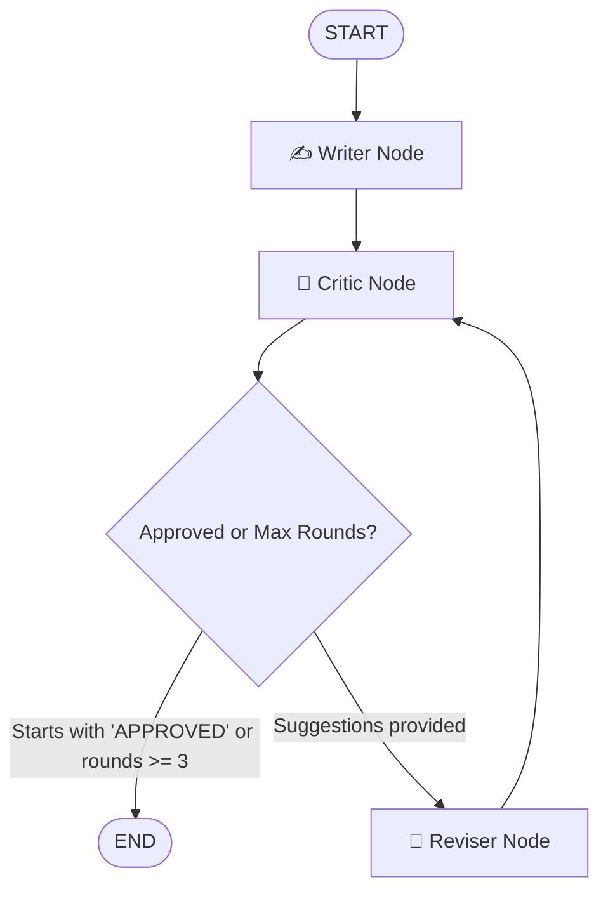

# Reflection Agent (LangChain + LangGraph)

A Reflection Agent in Python implementing the **Writer → Critic → Reviser** iterative feedback loop with LangChain, LangGraph, and Ollama (`llama3.2`). Available as both a **CLI** and an interactive **Web Application** (Streamlit).

---

## Architecture & Graph Flow



1. **`write` (Writer)**: Drafts the initial text (max 100 words).
2. **`critique` (Critic)**: Strict editor reviewing clarity, tone, grammar, and length.
   - Reply starts with `APPROVED` if good and within 100 words.
   - Otherwise provides 2–3 specific suggestions.
   - Code override: If draft exceeds 100 words, `APPROVED` is rejected and flagged.
3. **`revise` (Reviser)**: Rewrites the draft incorporating feedback, cutting text if needed.
4. **Loop Edge (`revise -> critique`)**: Re-checks revision until approved or `MAX_ROUNDS` (3) is reached.

---

## File Structure

- [app.py](file:///c:/Users/HP/Desktop/gen%20ai%20exercises/day%2019/reflection%20agent/app.py): Interactive Streamlit web interface with real-time step visualization.
- [agent.py](file:///c:/Users/HP/Desktop/gen%20ai%20exercises/day%2019/reflection%20agent/agent.py): System prompts, StateGraph nodes, `should_continue()`, `clean()`, `build_agent()`, `ask()`, and CLI `main()`.
- [tools.py](file:///c:/Users/HP/Desktop/gen%20ai%20exercises/day%2019/reflection%20agent/tools.py): Contains the `@tool` `count_words(text: str) -> str` reporting word count and category (`short`, `medium`, `long`).
- [requirements.txt](file:///c:/Users/HP/Desktop/gen%20ai%20exercises/day%2019/reflection%20agent/requirements.txt): Required Python libraries (`langchain`, `langchain-ollama`, `langgraph`, `requests`, `streamlit`).
- [test_agent.py](file:///c:/Users/HP/Desktop/gen%20ai%20exercises/day%2019/reflection%20agent/test_agent.py): Comprehensive unit tests covering tools, cleaning, nodes, override logic, and graph execution.
- [prompt.md](file:///c:/Users/HP/Desktop/gen%20ai%20exercises/day%2019/reflection%20agent/prompt.md): The full prompt specification.

---

## Quickstart

### 1. Prerequisites
Ensure Ollama is running and has `llama3.2` downloaded:
```bash
ollama pull llama3.2
```

### 2. Install Dependencies
```bash
pip install -r requirements.txt
```

### 3. Run as a Website (Streamlit UI)
To launch the browser interface:
```bash
streamlit run app.py
```
This automatically opens your browser at `http://localhost:8501`.

### 4. Run as a Terminal CLI
```bash
python agent.py
```

### 5. Run the Unit Tests
```bash
python -m unittest test_agent.py -v
```

---

## Web Interface Features

- **Live Reflection Tracker**: Watch the Writer draft, the Critic review, and the Reviser improve text in real time.
- **Word Count Badges**: Real-time length metrics using the `@tool count_words`.
- **Sidebar Controls**: Easily adjust Ollama model name, base URL, and temperature slider.
- **Quick Example Prompts**: Click one-click chips for common writing requests.
